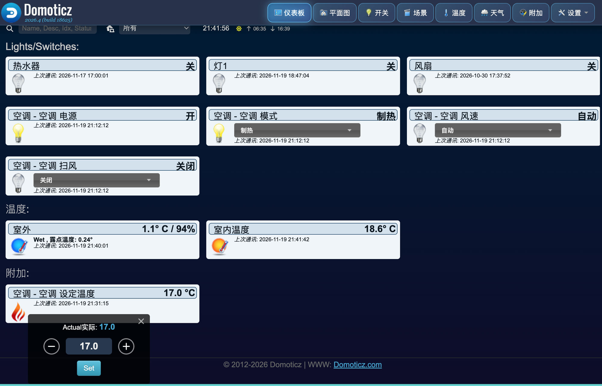

## 美的美居 Domoticz 插件

 `Meiju/` 目录是面向 [Domoticz](https://www.domoticz.com/) 的美的美居插件。



适用于 [Domoticz](https://www.domoticz.cn/) 的美的美居（Midea Meiju）设备控制插件。

协议与设备定义移植自 Home Assistant 集成 [hasscc/meiju](https://github.com/hasscc/meiju)，插件形态参考 [Zackr 的 Broadlink SP Mini 插件](https://www.domoticz.cn/forum/viewtopic.php?t=43)（本仓库 `BroadlinkSPMini/`：一台硬件对应一台设备、心跳刷新、开关控制）。

## 安装

1. 下载[Meiju.zip](https://github.com/DT27/meiju/releases/download/2026-11-26_091400/Meiju.zip)，将压缩包内整个 `Meiju` 目录复制到 Domoticz 的插件目录`domoticz/plugins/`

2. 插件依赖 AES 库：插件内置纯 Python AES，可直接使用。若已安装 `pycryptodome`（与 Broadlink 插件相同）会自动优先使用，速度更好：

   ```bash
   pip3 install pycryptodome
   ```

3. 重启 Domoticz。在 **设置 → 硬件** 中应能看到 **Midea Meiju (美的美居)**。

## 配置

| 参数 | 说明 |
| --- | --- |
| 美居账号 / 密码 | 美的美居 App 登录账号 |
| 设备 IP | 设备局域网地址。留空则走云端透明传输 |
| 端口 | 默认 `6444` |
| 设备 ID | 云端 `applianceCode`。可先留空 |
| 检测间隔 | 状态轮询秒数，默认 25 |
| 云服务 | 中国 `china` / 全球 `global` |
| 控制方式 | 自动（局域网优先）/ 仅局域网 / 仅云端 |
| 设备类型 | 可选，例如 `B3`。云端已返回类型时可留空 |
| 调试 | 在日志中打印状态字节 |

**获取设备 ID：** 先只填账号密码，「设备 ID (applianceCode)」留空后启用硬件。日志会按行打印：

```
applianceCode=**********  名称=空调  类型=0xAC  sn8=22040093
```

把 `applianceCode=` 后面那串数字填回硬件设置「设备 ID (applianceCode)」后重启。

登录会话和局域网 `key/token` 保存在 `Meiju/data/auth_账号.json`，避免每次启动都重新登录。

## 设备与控件

每个硬件实例对应一台美居设备，插件按类型自动创建 Domoticz 子设备：

| 类型 | 说明 | 控件 |
| --- | --- | --- |
| AC | 空调 | 电源、模式、风速、扫风、设定温度、室内/外温度、节能、强力 |
| B0 | 微波炉 | 状态 |
| B3 | 消毒柜 | 电源、锁定、上下层模式/温度/状态/门磁 |
| DB | 洗衣机 | 电源、状态 |
| E3 | 热水器 | 温度、水量 |
| EA | 电饭煲 | 状态 |

未知类型会创建通用 **电源** 开关和 **状态** 传感器（协议字节 11，与 hasscc/meiju 默认习惯一致）。可在 `meiju/customizes.py` 按设备类型或 `sn8` 增加定义，字段含义与 HA 的 `device_customizes.yaml` 相同：

- `get_extra` / `set_extra`：查询、控制时附加的字节
- `switches` / `selects` / `numbers` / `sensors` / `binary_sensors`
- `byte`、`on_value` / `off_value`、`on_extra` / `off_extra`
- `dict`、`state_template`（支持 `value`、`bytes[n]`、`\|bitwise_and`）

## 工作原理

1. 登录美的美居云（中国区 `mp-prod.smartmidea.net`）
2. 拉取家庭设备列表
3. 用 `applianceCode` 向云端换局域网 `token/key`，再与设备 `6444` 端口做 8370 握手
4. 按设备类型组查询/控制帧，轮询状态并更新 Domoticz。空调（`0xAC`）使用 msmart 位域协议（查询 `0x41`、整帧设置 `0x40`），其它类型按 `customizes` 字节映射

局域网失败时，「自动」模式会回退到云端 `/appliance/transparent/send`。

空调控制会把当前电源/模式/风速/扫风/设定温度等一并下发（与美的局域网协议一致），所以请等第一次状态刷新成功后再改设定。

## 依赖与致谢

- [hasscc/meiju](https://github.com/hasscc/meiju)
- [mac-zhou/midea-msmart](https://github.com/mac-zhou/midea-msmart) (`msmart==0.2.3`)
- [Zackr 的 Broadlink SP Mini 插件](https://www.domoticz.cn/forum/viewtopic.php?t=43)（本仓库 `BroadlinkSPMini/`）

